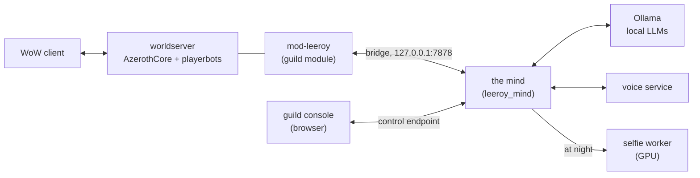

# leeroy

[](https://github.com/raold/leeroy/actions/workflows/ci.yml)
[](https://github.com/raold/leeroy/actions/workflows/patches.yml)
[](https://github.com/raold/leeroy/actions/workflows/build.yml)

A single-player World of Warcraft 3.3.5a (Wrath of the Lich King) server: one
human, a world full of [playerbots](https://github.com/mod-playerbots/mod-playerbots),
and a guild that is alive. The world's bots talk through a local LLM
([mod-ollama-chat](https://github.com/DustinHendrickson/mod-ollama-chat)). The
player's own guild, well over a hundred level-80 bots kept online for good, is
different: each member has a persona, memories and relationships, and speaks
through the mind in this repo, in guild chat, in a private guild Discord and,
with the voice service, aloud.

This repo is the customization layer on top of the
[mod-playerbots fork of AzerothCore](https://github.com/mod-playerbots/azerothcore-wotlk):
the guild module and its mind, the guild console, the voice service, the
profile-photo worker, the dojo, maintenance scripts, the tuned configs and local
patches. It contains no Blizzard data and no core source. Everything runs on
one PC, with local models only.

The goal it is named for is a bot raid leader. Much of it exists now:
[mod-dungeon-clear](https://github.com/jrad7/mod-dungeon-clear) has the group's
tank bot route boss to boss and pull, and the mind's raid nights assemble the
raid from the guild and give it a raid leader who calls the plan before each
boss. When the player leads, he can name a member as raid lead, and she runs
the calls and the marks while he gives orders in plain words. The boss fights
themselves are still played by playerbots' raid strategies, now with written
boss playbooks and better hazard avoidance beside them; teaching the bots to
fight better is the work of the
[training ground and the dojo](#teaching-the-bots-to-fight).

## A tour

What the player sees:

- **In game**, the guild greets him, talks in guild chat, whispers him, answers
  his questions, reacts to his emotes, and remembers what happened between
  them. Each member has her own way of talking, her own mood and her own view
  of the others.
- **Raids**: he asks for one and the guild answers. It picks a fair
  composition, forms and summons the raid, and a raid leader calls each boss.
  Loot goes through master loot and DKP. `.playerbots bot add10` fills his
  group from the guild rather than with strangers.
- **Voice rooms**: members speak aloud, each in a voice of her own, and he
  answers with push-to-talk.
- **The guild's Discord**, a private server inside the console: members talk
  there around the clock, in and out of game, about their raids, their days
  and the guild's running jokes. They DM him, answer his DMs at length, send
  him their photos (and a fresh selfie when he asks for one) and voice notes,
  and bring up what they meant to tell him. He can start group DMs with a few
  of them.
- **The guild console**, a browser page beside the game (and on his phone over
  his tailnet): tonight at a glance, the guild's chat and its Discord, the raid
  night, the roster and DKP, the members' profiles and photos, the guild's
  drama, the forum, the bank, what the guild is learning and the health of
  everything behind it.
- **While he is away**, the guild lives on. At night members gossip, make and
  break friendships, remember and forget, write stories and a chronicle, and
  pose for new profile photos. The guild runs raids of its own. Rival guilds
  in the realm race it for first kills.

## How it works



- **The game server** is the mod-playerbots fork of AzerothCore with a handful
  of local [patches](#patches). The world's ordinary bots are playerbots, and
  they chat through mod-ollama-chat.
- **mod-leeroy**, the guild module (`modules/mod-leeroy`), keeps the guild's
  bots pinned online with their consumables topped up, mutes them in
  mod-ollama-chat so only their own mind speaks for them, and runs a local
  bridge: newline-delimited JSON on `127.0.0.1:7878`, through which an outside
  process sees the guild and speaks and acts for its members.
- **The mind** (`mind/`, Python) is that process. It keeps every member's
  persona, memories and relationships in a local SQLite database, decides who
  speaks and when, and writes each line on a local model through Ollama.
- **The guild console** (part of `mind/`) is a separate local web server. It
  reads the mind's database and asks the mind to act through a loopback control
  endpoint, so it can also start and stop the mind.
- **The voice service** (`voice/`) speaks lines aloud and turns push-to-talk
  into text; **the selfie worker** (`selfie/`) renders profile photos on the
  GPU at night. Each is a separate process with its own environment.
- **The dojo** (`dojo/`) is apart from all of this: its own worldserver,
  database and ports, for training combat policies, never touching the live
  realm.

Nothing new is on by default: each optional feature sits behind a switch in
`mind.toml` or the module config, and an invalid setting means off.
Personas, memories, prompts, photos and logs stay in the ignored `mind-data/`.

## The mind

Each guild member has a persona card, memories with privacy scopes, moods and
relationships. The mind decides who speaks and when, and writes each line in
that member's own voice and typing style, without letting a member say what she
could not know: whispers stay with their pair, officer chat with the officers,
and a member knows only what she saw, was told or overheard. Each member has
one mind across game and Discord: her whispers and her DMs with him are one
conversation, officer chat and the officers' Discord channels are one officer
audience, and a group DM is shared only with those who were in it.

- **Talk**: guild chat, whispers and replies to the player, conversations
  members start with him, things each member means to tell him, answers to his
  emotes, and reactions to raids, loot and what happens in game. Members keep
  their own typing rhythm, banter, and share running jokes born from things
  that really happened, teasing only where they are friends, and talk about
  the server's real calendar events and real loot. Before a line is
  sent, guards check it against what she knows and recently said, and drop
  repeats, filler and a reply that only says his message back.
- **Decisions**: the guild records what it decides, who argued what and how
  each member voted, with officers' polls; votes and positions come from each
  member's data, never from model text, and he can overrule a decision where
  the game allows it.
- **Godmode**: he can edit a member's traits, feelings, mood, life events and
  memories, and start or end a feud, each as an overlay that undo removes
  exactly; and he can give a member something to do in Discord, which she
  carries out in her own way or reports back as not taken.
- **Guild life**: raid nights from call to loot (a fair composition, a rotating
  raid lead, summons, the dungeon-clear run, DKP and an MVP vote), offline
  raids the guild runs on its own while he is away, a group he fills with
  `.playerbots bot addN` counted like a called raid night, and the ranks,
  specs, gear, flask and feast habits kept current between raids. In a group he
  leads he can name a raid lead (from the console or in raid chat) who does the
  pull countdown, the marks and the boss calls, and he can give orders in raid
  chat or by push-to-talk (follow, stack, spread, wait for my pull, kill skull,
  tanks swap, Bloodlust now) that the bodies carry out, acknowledged only once
  the game confirms them. Offline raids skip any raid he is saved to that week
  and say in words why a run stopped. A healer in
  his group rezzes the dead out of combat. Optional play styles let members use
  potions and hold a moment before a pull in their own way outdoors, never in
  instances or raids.
- **Nights**: once he is offline and the GPU is idle, the mind consolidates and
  forgets old memories, spreads gossip and corrects rumours, moves
  relationships, feuds and mentorships along, lets jokes, nicknames and slang
  spread and fade, and writes stories, raid recaps, a guild chronicle and
  season awards. It stops the moment he logs in and resumes where it left off.
  Members who join the cast later can be given a persona at night.
- **The Realm**: the world outside the guild. Three rival bot guilds (a
  progression rival, a drama farm and Alliance gankers) talk in Trade and
  General and race the guild for first kills. There are also canon
  achievements, the guild bank, a guild calendar with raid nights and
  birthdays, mail and gifts to the player, a guard against kicking the cast,
  and a forum whose posts and letters he can answer from the console.
- **The game library**: the [library](mind/leeroy_mind/library/README.md) the
  mind reads for facts in its answers: warcraft.wiki.gg's WotLK pages,
  AtlasLoot, the world database and client data, pinned AzerothCore
  documentation and the server's own command references, with text and vector
  search.
- **Measuring it**: a weekly evaluation checks persona consistency, social
  behaviour, memory and secret-keeping, and talk quality (contradiction,
  repetition, non sequiturs, unawareness), always on scratch copies of the
  database and never by sending anything in game.

### Learning

A self-improvement loop in which the guild learns from how the player
responds. Each piece is off by default, and none writes chat text to its logs.

- **Member claims** (`[claims]`): a night stage remembers each member's own
  facts, opinions and plans, with a model-free contradiction check. See the
  [claims guide](mind/leeroy_mind/claims/README.md).
- **Signals** (`[signals]`): numbers only on how the player responds to each
  member's line (a reply, how soon, how long), plus his thumbs.
- **Rewards** (`[learn]`): each member line gets a score from his measured
  response, with quality defects deducted; silence scores zero.
- **Variants and a bandit** (`[learn] bandit`): variants of how a line is
  written, and a learner that keeps the ones that land.
- **A nightly coach** (`[learn] coach`): lessons from each member's best and
  worst exchanges, held for the player's approval.
- **Live use** (`[learn] apply`): learned variants and approved lessons shape
  live lines, each within its own audience.
- **Typing style** (`[fingerprint]`): each member's measured way of typing, so
  she keeps her own voice.
- **Shared memories** (`[callbacks]`): picks a fitting memory for a member to
  bring up, within the same privacy rules.
- **Preference data** (`learn export`, `learn evalset`): private preference
  pairs and an evaluation set for an optional fine-tune, never committed.

The console's Lab tab shows the rewards, variants and lessons, puts thumbs on
every member line, and can freeze learning. See the
[learning guide](mind/leeroy_mind/learn/README.md).

## The guild console

`python -m leeroy_mind console` serves one local browser page on
`127.0.0.1:7881`, dark by default with a remembered light/dark switch and a
Hide photos switch. A Free GPU button in its top bar unloads every model so the
player can play something else, until he resumes or logs into WoW. Its 16 tabs:

| Tab | What |
|---|---|
| Tonight | Tonight at a glance: raids and sign-ups, what is waiting for him (DMs, letters, photo picks, polls), who is due loot, bank items running low, his own flasks, potions and food, the week ahead and the last night; plus which feature switches are on |
| Comms | The voice rooms and the game's chat in one feed with the members' faces, channels, whispers, a voice transcript, mute and deafen, a reply box that speaks in game as the player, and **the guild's Discord**: channels, private DMs and group DMs, emoji, reactions, reply quotes, threads, pins, photos and voice notes both ways. Members talk there on their own around the clock and answer even while he is out of game; DMs are as private as whispers, nothing in it becomes WoW chat, and every conversation is kept |
| Raid | The raid night as it happens (call, composition, members, loot, DKP), recent raids, the raid actions (call, form, summon, start, stop, end), and the raid lead picker |
| Guild | Roster, DKP ladder and stats (attendance, who is due an item), loot history, season awards, the chronicle, and the guild's decisions and polls with his vote and overrule |
| Social | Feuds, jealousy, romances, how members feel about him, rumours, the guild mood |
| Personas | The cast as a wall of faces or a table: mood, stance, ties, memories, persona versions, what each means to tell him; their insight (claims, awareness, talk quality); tuning dials at world, group and member level with undo; temporary nudges; godmode edits with undo; choosing profile photos and browsing each member's gallery |
| Board | The Realm's forum, letters and write-ups, where he can reply |
| Calendar | Raid nights, the officers' meeting, birthdays and sign-ups |
| Bank | The guild bank's gold, tabs and money log, read through the mind so the database password stays with it |
| Realm | Rival guilds, the race for first kills, poaching, Trade lines |
| Training | The training ground's fights, gate, trials and cards, what hurt the members per boss, and the raid playbooks |
| Dojo | The dojo's builds, baselines and runs, read from its own files |
| Library | Search of the game library, text first, the mind's semantic search as a fallback |
| Lab | What the guild is learning: line rewards, variants and lessons (approve, veto, retire), reward weights, and a freeze; thumbs on every member line feed it |
| Ops | Health, nights, held Realm moves, raids, photos, backups and release drift; optional actions, each previewed and confirmed |
| Mind | The game server, the mind and the voice service, with start, restart and stop |

It runs apart from the mind and talks to it only through the loopback control
endpoint, with a per-start key. Away from home the player opens it over his
tailnet (`tailscale serve` to `https://<pc>.<tailnet>.ts.net`, never Funnel)
with a bookmarked stable key, rotated with `console rotate-key` if a device is
lost; a logon task (`scripts/ac-console-schedule.ps1`) keeps it running.

## Voice

The voice service speaks the guild's lines aloud in voice rooms, each member in
a voice of her own, and turns the player's push-to-talk into text for the mind.
It runs beside the mind; if it is down, the guild types in chat as before.
It also renders members' voice notes for Discord DMs and transcribes the ones
he records back. Playback keeps each engine's native sound. Every voice is a blend of synthetic
stock voices, none cloned from a real person.

Its default loopback ports are 7879 for the mind and 7880 for its browser
panel. Runtime settings and models stay in the ignored `voice-data/`; voice
specs and synthetic references stay in `mind-data/voices/`. The
[voice README](voice/README.md) covers setup, GPU warmup and the optional
Chatterbox Turbo CPU fallback. A
[headless regression rehearsal](voice/tools/rehearsal/README.md) checks the two
services together in CI, with synthetic data and fake audio devices.

Voice dependencies include pedalboard (GPL-3.0) and
[eSpeak NG](https://github.com/espeak-ng/espeak-ng/blob/master/COPYING)
(GPL-3.0, loaded through espeakng-loader). The model pins in
[models.py](voice/leeroy_voice/models.py) record revisions and licenses:
Kokoro-82M (Apache-2.0), NVIDIA Parakeet TDT 0.6B v2 (CC-BY-4.0),
Silero VAD (MIT), SpeechBrain ECAPA (Apache-2.0), and the optional
Whisper large-v3-turbo and Chatterbox Turbo models (MIT).

## Profile photos

With `[selfies] enabled = true` the mind picks a photo kind for each member who
has looks and, at night only, has the `selfie/` worker render four candidates
each with RealVisXL on the local GPU. The player picks one, undoes it or asks
for four more in the console's Personas tab, and can browse each member's
earlier photos and make any of them the cover. An optional photo booth renders
requested sets between nights. Rendering never runs while he is in game, and
every image passes a local NSFW check first; members are adults, clothed, and
never anyone's likeness. See [selfie/README.md](selfie/README.md).

With `snaps = true` as well, the night plans and renders situational photos
from members' days and a guild photo after a raid night, each keeping the
member's face through an IP-Adapter. With `[photos] send = true` members send
them: to him in a DM, or posted in the Discord channel the scene fits, rationed
by a weekly dial, and never a private one in a channel. With `requests = true`,
a member he asks for a photo of herself sends a fresh one, rendered on request
while he is out of WoW (his words never reach the image prompt). He can post
his own photos in the Discord too, and members look at them.

## Teaching the bots to fight

### The training ground

The optional training ground records completed fights, checks observable
mechanics, and compares tactics on established farm encounters. Adaptation
requires at least 28 days of eligible received records and a passed overhead
gate. Reports separate fixed score bases, incomplete coverage, desired setups
and verified observations. An offline tactic win followed by recorded use in a
human raid proves adoption; it does not establish a causal improvement in that
raid. Requested damage counters cannot establish actual boss DPS, and dummy
results cannot establish a field rotation win. Voice send records do not prove
audible playback or complete callouts.

Training is disabled by default. Private records live in the mind data
directory's `mind.db` (`tg_` tables and scoped receipts). Use `python -m
leeroy_mind training status`, `training report --week YYYY-Www` and `training
trials` to inspect them. With the mind stopped, `training rollback --context
MAP:BOSS:DIFFICULTY` or `training stock --context ...` changes the stored card
selection under the service lock, while preserving pending command journals.
Native `Leeroy.Training.Enable = 0` stops additions and requests verified
cleanup, which may remain pending; `Leeroy.Telemetry.Enable = 0` stops
recording.
Implementation and passing tests are separate from live observation and
acceptance.

It records the player's own raids as well as the guild's offline ones: while
its overhead check runs, recorded and unrecorded pulls alternate, and nothing
but the recording switch reaches his raid. `python -m leeroy_mind training
hurt` (and a Training tab panel) reports, per boss, what killed members, the
spells that hurt them most, the mechanics they failed and who took avoidable
hits.

### Raid playbooks

`mind/leeroy_mind/raidplay/` holds a playbook per boss and difficulty for
Naxxramas, Icecrown Citadel and Trial of the Crusader, as data: each mechanic's
spell ids, kind (avoid the ground, leave a cone, spread, stack, run out with a
debuff, interrupt, dispel, tank swap and so on), roles, distances and whether
playerbots' own boss script already handles it. The entries are checked
against the core's boss scripts and spell data; tactics are written in this
project's own words. The training ground scores each entry, and a local-only
extractor can read facts from an installed boss-mod addon into the data
directory for cross-checks (never into the repo). See the
[raidplay README](mind/leeroy_mind/raidplay/README.md).

### Hazards

With `Leeroy.Hazards.Enable = 1`, guild members in the player's group step out
of avoidable ground effects out of combat as well as in it, never take a
follow spot inside one, and walk around one rather than through it, with a
breaker so a bot is never stranded between overlapping hazards.

### The dojo

The dojo is where the bots' combat is to be trained with deep reinforcement
learning, on a worldserver of its own. It has its own AzerothCore and
playerbots checkouts, build tree, MySQL instance, loopback ports and synthetic
fixture characters, and its preflight (`scripts/dojo/preflight.ps1`) refuses
any layout that overlaps the live install. Nothing in it touches the live
realm.

What exists is the foundation:

- **Protocol**: an environment protocol written twice, in pure C++
  (`modules/mod-dojo/src/Lib`, no AzerothCore includes) and in Python
  (`leeroy_dojo`), with a loopback transport.
- **Native side**: `mod-dojo`, a module built only into the dojo's core, and
  one playerbots commit (`patches/dojo/`) that hands chosen actors to an outside
  controller.
- **Training realm**: a disposable arena with two fixture actors. The
  controller has exclusive control of them through a narrow executor that acts
  like a client, and each actor sees only what is visible to it, after a
  perceptual delay.
- **Episodes**: each one resets by tearing the arena down and building it
  again. The dojo decides the outcomes and rewards, and a checksummed recorder
  writes episodes that replay without a game client.
- **Baselines**: `noop`, `random_legal` and `frost_duelist` (an authored Frost
  Mage script). The stock playerbots AI runs as a separate system benchmark.
- **The G1 evidence run**: it runs all of the above and checks each episode
  against the core's own scoreboard.

There is no learner yet, and no learned policy is claimed. PPO and its
multi-agent form are the planned first baselines (see [Research](#research)).
The Python package uses only the standard library, on Python 3.12. CI runs its
suite, the C++ protocol tests and a fake-worker smoke test. The
[dojo README](dojo/README.md) has the layout, the protocol and the commands.

## Patches

The local commits this server carries on its modules, as `git format-patch`
output in `patches/`:

- **Raid Browser listings**: idle randombots list themselves in the Raid
  Browser, so it is not empty.
- **`.playerbots bot add5|add10|add25|add40`**: fills your group to a 5-man
  party or a 10/25/40-man raid with a sensible tank/healer/damage mix at your
  level, with proper specs and gear. For the player, mod-leeroy fills it from
  his guild instead. It leaves out members saved to another copy of a raid or
  heroic he is saved to at that size, and when he takes the group into an
  instance, members saved to another copy of it (whom the core would turn away)
  are named, leave his group and are replaced from the guild.
- **Raid habits**: those bots follow in arrow formation, and damage dealers
  hold a few seconds into a pull so the tank gets threat.
- **Bots past level 80**: bots that take the level of a master above 80 get the
  level-80 premade talents instead of none.
- **Pinned random bots** (playerbots): an API other modules use to keep chosen
  random bots permanent and online, never re-rolled, teleported or pulled out
  of their group, and never logged out to meet the online bot count. A pinned
  bot revives in place, skips playerbots' canned status and hello whispers,
  and stays out of random bot arena teams. mod-leeroy pins the guild with it.
- **Hazard-aware follow spots** (playerbots): an inert hook another module can
  install so a bot's follow position, and its way out of a ground effect,
  avoid known hazards. mod-leeroy installs it for the player's group only.
- **Speaker filter** (mod-ollama-chat): lets another module keep chosen bots
  out of the LLM chat, so the guild speaks only through its own mind. A queued
  reply asks the filter again before it is delivered.

Apply them to a checkout of each module with
`git am /path/to/leeroy/patches/<module>/*.patch`.

## Running it

### Layout

| Path | What |
|---|---|
| `scripts/` | Update, backup, build, release, start/stop, health, voice, guild-backup and snapshot scripts (Git Bash on Windows), and `scripts/dojo/` (PowerShell, for the dojo's isolated build) |
| `config/` | Snapshots of the live server and module configs, secrets masked |
| `patches/mod-playerbots/` | Local playerbots commits, as `git format-patch` output |
| `patches/mod-ollama-chat/` | Local mod-ollama-chat commits, same format |
| `patches/dojo/mod-playerbots/` | The dojo's own playerbots commit (an external-controller hook), applied on top of the local commits in the dojo's isolated checkout only |
| `modules/mod-leeroy/` | The guild module and its bridge, with unit tests and a smoke test in `tools/` |
| `modules/mod-dojo/` | The dojo's native module, built only into the dojo's isolated core (the CI build compiles its disabled variant) |
| `mind/` | The mind (`python -m leeroy_mind run`) and the guild console (`python -m leeroy_mind console`) |
| `voice/` | The voice service (`python -m leeroy_voice`), Python 3.12; GPL-3.0-or-later, with its own [LICENSE](voice/LICENSE) and [README](voice/README.md) |
| `selfie/` | The profile-photo worker (`python -m leeroy_selfie`), Python 3.12, started by the mind at night only; GPL-3.0-or-later, with its own [LICENSE](selfie/LICENSE) and [README](selfie/README.md) |
| `dojo/` | The dojo (`python -m leeroy_dojo`); see [its README](dojo/README.md) |
| `references.bib` | The research, software and models behind the project, each entry annotated with what it shaped |

### Scripts

```bash
./ac-update.sh [--dry-run]   # pull core + git modules, rebasing local patches
./ac-backup.sh [label]       # mysqldump all four databases
./ac-build.sh                # preflight checks, configure, build
./ac-release.sh [--native] <commit>...  # deploy merged main commits, with snapshot and rollback
./ac-server.sh start|stop|status # the game servers and the mind; stops the worldserver cleanly over local SOAP
./ac-voice.sh start|stop|status  # the voice service
./ac-health.sh [--json]      # read-only health check of the live install
./ac-guild-backup.sh         # verified, pruned backups of the guild's data to another machine
./ac-snapshot.sh             # copy live configs and module patches into this repo
```

They assume this repo is the install root, with the core checked out in
`azerothcore-wotlk/` and the build in `build/`.

### CI

| Workflow | When | What |
|---|---|---|
| `ci` | main pushes and pull requests | shellcheck on `scripts/`, gitleaks over each push's and pull request's commits, the mod-leeroy and mod-dojo unit tests, the mind's Python 3.14 suite, the console's browser tests, the voice and selfie Python 3.12 suites, the dojo's suite and fake-worker protocol smoke, and a headless cross-service rehearsal in separate environments |
| `patches` | patch changes, nightly | applies the patches to the newest upstream mod-playerbots, then the dojo's series on top (plus playerbots' codestyle check), and to mod-ollama-chat; a nightly failure opens a `patch-drift` issue |
| `build` | patch or module changes, weekly | compiles the fork core with the patched playerbots, mod-leeroy and mod-dojo's disabled variant (clang, `-Werror`, ccache) |
| `release` | `v*` tag | GitHub release with the patches, modules, configs and scripts |

There is no deploy job: the server runs on one PC and is updated with the
scripts above. A self-hosted runner on a public repo would let any pull request
run code on that PC.

## Research

[references.bib](references.bib) lists the 282 papers, books, software and
models behind the project. Each entry notes what it shaped, or, in the dojo's
section, what it is planned for. The main threads:

- **Generative agents.** Park et al.'s *Generative Agents* (2023) is the
  Smallville experiment, in which 25 agents lived in a simulated town. It gave
  the mind its memory stream, the recall score (recency, importance,
  relevance), nightly reflection and per-pair relationships. Anderson and
  Schooler (1991) and the FSRS forgetting curve shape how memories fade.
  MemGPT's self-editing memory was kept off the live path because of its
  latency.
- **Theory of mind.** Each member must know only what they could know. LLMs'
  theory of mind breaks under trivial changes to a task (Ullman 2023), so the
  mind tracks per member who knows what rather than trusting the model, after
  FANToM (Kim et al. 2023) and TimeChara (Ahn et al. 2024). The weekly
  evaluation probes secret-keeping, after Mireshghallah et al. (2024).
- **Relationships and social life.**
  - Disclosure is paced by social penetration theory (Altman and Taylor 1973)
    and Aron et al.'s closeness procedure (1997).
  - Moods follow ALMA (Gebhard 2005) and emotional contagion (Hatfield et al.
    1993).
  - Gossip, nicknames and slang follow the psychology of rumour (Allport and
    Postman 1947), naming-game dynamics (Baronchelli et al. 2006) and Dunbar et
    al. on conversation (1997).
  - Each member's drives are weighted by Yee's motivations for play (2006).
- **Evaluation.** SOTOPIA (Zhou et al. 2024), PersonaGym (Samuel et al. 2025)
  and LoCoMo (Maharana et al. 2024) shaped the weekly persona, social and
  memory checks.
- **Reinforcement learning for combat.**
  - PPO (Schulman et al. 2017) and its cooperative multi-agent form, MAPPO (Yu
    et al. 2022), are the dojo's planned first baselines.
  - AlphaStar's league (Vinyals et al. 2019) and OpenAI Five (OpenAI 2019) are
    the references for later self-play.
  - Reflexion (Shinn et al. 2023) and Voyager (Wang et al. 2024) are the models
    for the training ground's planned post-fight reflection and growing tactic
    library.

## License

GPL-2.0, matching AzerothCore and mod-playerbots, except the separate `voice/`
service and `selfie/` worker, which are GPL-3.0-or-later under [voice/LICENSE](voice/LICENSE)
and [selfie/LICENSE](selfie/LICENSE).
